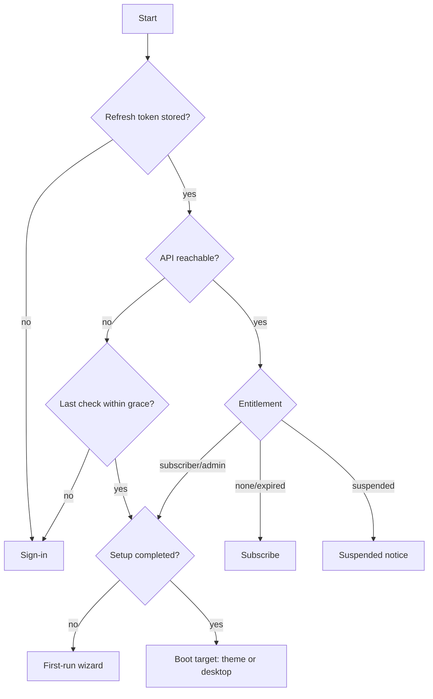

# 04 — Information architecture & user flows

Screen-level detail lives in [screen-specifications.md](screen-specifications.md). This document
covers structure and journeys.

## 1. Launcher structure

The launcher has three layers. Only one is visible at a time.

```
Gate layer        (blocks everything until resolved)
 ├─ Splash / boot
 ├─ Sign-in
 ├─ Subscribe            (signed in, no entitlement)
 └─ First-run wizard     (entitled, never completed setup)

Front-end mode    (fullscreen theme; default after boot)
 └─ Theme → menu levels → game list → game details → launch

Shell (desktop)   (reached with M / Start "Desktop", hidden in kiosk mode)
 ├─ Desktop, taskbar, start menu, notifications
 └─ Apps (windows)
     ├─ Library          browse/search/edit games, scan, scrape; collections (order, Add games…) and smart filters
     ├─ Catalog          browse/install online games; Downloads tab
     ├─ Menu Editor      menus (several, one active), tree, node form, Not in this menu, preview
     ├─ Themes           pick theme, pack coverage
     ├─ Settings
     └─ Account          profile, plan, devices, sign out
```

### Settings sections

| Section | Contents |
|---|---|
| General | Language, boot target (last theme / theme / desktop), startup with Windows, UI scale |
| Storage | Storage locations + priority, launcher-managed download location, media location mode |
| Systems | Enable/disable systems; per system: ROM folder name, extensions, default emulator profile, scraper ID, theme override |
| Emulators | Emulators (executables), profiles (templates, cores, hooks), presets, Test launch |
| Themes | Per-theme options (art order, logo variant, video, game art per system, wheel, sounds), asset folder, themes folder |
| Input | Gamepad and keyboard mappings per action, repeat timing |
| Scraper | ScreenScraper credentials, region/language priority, default art kinds |
| Kiosk | Enable, PIN, what is hidden |
| Sync | Cloud sync on/off and status (M10) |
| Backups | Settings backups list, restore, export/import |
| Data & logs | Paths, open folder, launch log, app log, rebuild library index |
| About | Version, update channel, licenses |

### Navigation rules

- **Front-end ↔ shell:** `M` / gamepad *View + Start* minimizes the theme to the desktop; the
  taskbar entry or *Start → Front-end* returns to the exact same focus. As built (M4b): the
  front-end is a fullscreen layer above the shell that stays mounted while hidden; the shell is
  inert while it shows. Boot routing (F2) ends in the boot target, or the desktop while the
  library has no games; the first-run wizard joins it in M9.
- **Errors link to their fix:** any failure that has a setting behind it (missing emulator, bad
  path) offers a deep link `settings://emulators/<id>` that opens Settings on that field. As
  built (M3): launch errors carry `details.fix = { section, id? }`, and **Fix in Settings** opens
  the Settings window (or switches the open one) on that section with that item's editor open.
- **Back is always available:** `Esc` / gamepad B goes up one level; at the root it opens the
  theme menu (Desktop · Switch theme · Resume). As built (M4c): *T* opens the theme switcher
  from any level; switching keeps the level and the focused game.

## 2. Admin console structure

```
Sign-in (Google, admin role required)
 ├─ Dashboard        subscribers, downloads, alerts
 ├─ Users            list → user detail (subscription, devices, grants, audit)
 ├─ Plans            list → plan editor
 ├─ Catalog          list → item editor (metadata, files, art, license, publish)
 ├─ Systems          catalog system list used for item metadata (read from shared package)
 ├─ Audit log
 └─ Settings         grace period, sign-up mode, maintenance banner
```

## 3. Key user flows

### F1 — Sign-in (desktop OAuth)

```mermaid
sequenceDiagram
  participant L as Launcher
  participant B as System browser
  participant G as Google
  participant A as API
  L->>L: create PKCE verifier + state, start loopback listener 127.0.0.1:<random>
  L->>B: open accounts.google.com/o/oauth2/v2/auth?…&redirect_uri=http://127.0.0.1:<port>/callback
  B->>G: user consents
  G->>B: redirect to loopback with code
  B->>L: GET /callback?code&state
  L->>A: POST /auth/google/exchange {code, verifier, redirectUri, device}
  A->>G: exchange code, verify ID token
  A->>L: {accessToken, refreshToken, entitlement}
  L->>L: store refresh token with safeStorage; route by entitlement
```

### F2 — Boot routing

As built (M7b): `BootGate` loads settings (language first), then `AuthGate` routes by main's
`AuthState`; a stored session is refreshed online, or allowed offline while
`last check − 5 min ≤ now < last check + grace` on this PC's clock. The entitlement is checked
again every hour while signed in. Development builds can turn the gate off (`NEXTLEVEL_AUTH=off`).



### F3 — First run

Sign in → **Systems** (pre-selected popular ones) → **ROM folders** (add / skip) → scan with
live counts → **Emulators** (for each enabled system with games: preset + pick executable /
skip) → **Theme** (gallery) → front-end. Skipping all → Catalog "Starter set".

As built (M9g, D48): after the sign-in gate, `BootGate` shows the wizard while
`general.setupCompletedAt` is null, decided once per start (Settings → General → **Run setup again**
clears it; the wizard shows at the next start). At boot main marks an existing install (any storage
location or game) complete, so it never sees the wizard. Steps: Systems (popular ones ticked: NES,
SNES, N64, Game Boy, GBC, GBA, Genesis, Mega Drive, Master System, PlayStation, PS2, MAME; search
adds others) → Game folders (Add folder…, priority order, **Scan now** with live progress and games
per system) → Emulators (each enabled system with games: Ready, or **Locate executable…** — the
program becomes an emulator from its preset — and **Official site**, the system's best preset
homepage; nothing is downloaded) → Look (where NextLevel starts) → Done: **Start** with games,
**Browse catalog** without (the desktop with the Catalog open on Browse, Starter set first).

### F4 — Play a game

Focus game → Play → resolve profile (game override → system default) → validate (executable
exists, ROM exists, all tokens resolvable) → hide front-end → spawn → wait for exit → record
play → restore window and focus. Any validation failure shows a dialog with the reason and
**Fix in Settings**.

### F5 — Install from catalog

Catalog item → Install → entitlement check (API) → signed URL → queued download → resume on
restart → checksum → move into managed storage → insert game + metadata + art → notification
"Ready to play" → Play.

### F6 — Import NextLevelOS

Settings → Data → **Import NextLevelOS** → choose the `public\data` folder (the emulators folder is
pre-filled with `<parent of the first storage location>\emulators` when it exists, D14) → **Dry run**
(read-only, with the would-be system folders walked) → report (counts, entries with/without files,
new files, mapped / not imported / will replace, with reasons) → **Import…** (asks) → stages with
progress: settings (one backup) → scan of the imported systems → games → collections → menus →
summary with **Open Library** / **Open Menu Editor**. A folder changed since the dry run asks for a
new one; re-running is safe (D12).

### F7 — Subscribe

Subscribe screen → choose plan → browser opens Stripe Checkout → success page → webhook
updates subscription → launcher polls `/me/entitlement` every 3 s for up to 2 min → unlock.
