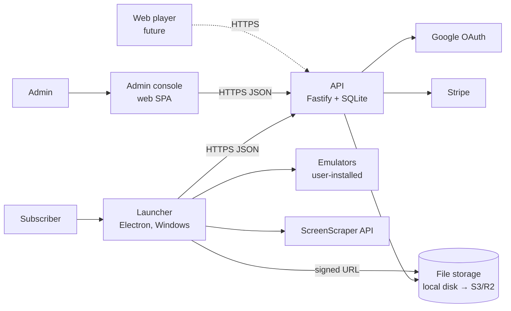
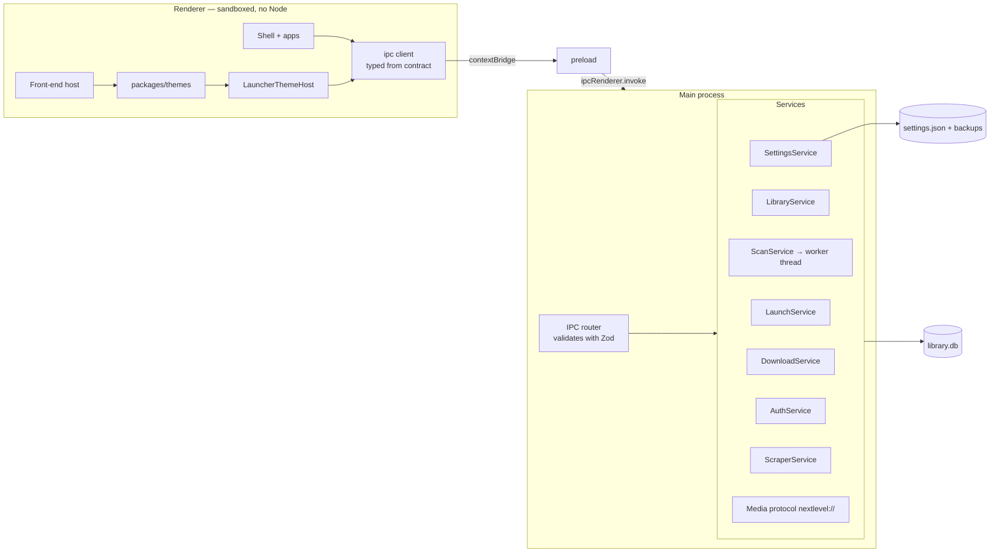

# 05 — Software architecture & technical design

How the system is built. Decisions are justified in [ADRs](adr/); schemas are in
[data-model.md](data-model.md); endpoints and IPC channels in [api-spec.md](api-spec.md).

## 1. System context



## 2. Technology stack

| Layer | Choice | ADR |
|---|---|---|
| Language | TypeScript 5 (strict) everywhere | [ADR-002](adr/ADR-002-keep-current-stack.md) |
| Monorepo | npm workspaces | [ADR-001](adr/ADR-001-monorepo.md) |
| Desktop | Electron (current major), built with `electron-vite` | ADR-002 |
| UI | React 19, Vite, Tailwind CSS 4, Motion, Lucide, TanStack Virtual, TanStack Query | ADR-002 |
| Validation & contracts | Zod (settings, IPC, API) | [ADR-005](adr/ADR-005-zod-contracts.md) |
| Local data | `better-sqlite3` 13 + Drizzle ORM (library), JSON file (settings). v13 ships N-API prebuilds, so one binary serves Node (tests) and Electron with no native rebuild | [ADR-003](adr/ADR-003-local-storage.md) |
| Backend | Node 24 LTS, Fastify, Drizzle ORM, SQLite (Postgres later) | [ADR-007](adr/ADR-007-backend.md) |
| Auth | Google OAuth 2.0 / OIDC; API-issued JWT access + rotating refresh tokens | [ADR-006](adr/ADR-006-google-sign-in.md) |
| Billing | Stripe Checkout + Customer Portal + webhooks | [ADR-009](adr/ADR-009-stripe.md) |
| Tests | Vitest, Testing Library, Playwright (Electron + web) | — |
| Packaging | electron-builder (NSIS), electron-updater | — |

## 3. Repository layout

```
nextlevel/
├── apps/
│   ├── launcher/            Electron app
│   │   ├── src/main/        main process: services + IPC handlers
│   │   ├── src/preload/     typed bridge (contextBridge)
│   │   └── src/renderer/    React UI: shell, apps, front-end host
│   ├── admin/               React SPA (Vite)
│   ├── api/                 Fastify server
│   └── web-player/          (future)
├── packages/
│   ├── shared/              Zod schemas + types: settings, systems, IPC contract, API contract, tokens
│   ├── system-catalog/      versioned system definitions + emulator presets (data + loader)
│   ├── themes/              themes engine + 6 themes (no Electron, no Node imports)
│   ├── ui/                  shared React primitives (buttons, forms, dialogs, design tokens)
│   └── config/              shared tsconfig, eslint, vitest presets
├── docs/                    these documents
├── CLAUDE.md · AGENTS.md · CHANGELOG.md · README.md
```

**Dependency rule:** `apps/*` may depend on `packages/*`; `packages/*` never depend on `apps/*`;
`packages/themes` and `packages/ui` never import Node or Electron APIs. Enforced by ESLint
(`import/no-restricted-paths`).

## 4. Launcher

### 4.1 Process model



- **Renderer** has `contextIsolation: true`, `sandbox: true`, `nodeIntegration: false`. It only
  calls the typed bridge `window.nextlevel` generated from the IPC contract.
- **IPC router** looks up each channel in the contract, validates input with Zod, calls the
  service, validates output in development, and returns `Result<T, AppError>` (never throws across IPC).
- **Events** (scan progress, download progress, settings changed, entitlement changed) go
  main → renderer on typed event channels.
- **Services** are plain classes with constructor-injected dependencies (DB, settings, clock,
  fs, spawn) so they are unit-testable without Electron.

### 4.2 Services

| Service | Responsibility |
|---|---|
| `SettingsService` | Load/validate/migrate `settings.json`; atomic save with rotating backups; emits `settings:changed` |
| `LibraryService` | Queries and mutations on `library.db`: games, metadata, user state, collections, menus, search (FTS5) |
| `ScanService` | Walks storage locations in a worker thread; diffs with library; reports progress; marks missing |
| `LaunchService` | Resolves launch profile, renders the template, validates, spawns, waits, records launch log |
| `DownloadService` | Queue, resumable HTTP range downloads, checksum, install into managed storage, uninstall |
| `AuthService` | Loopback OAuth flow, token storage (`safeStorage`), refresh, entitlement cache + grace logic |
| `ScraperService` | ScreenScraper client (TypeScript port of `scrappers/`), rate limiting, cache |
| `MediaIndex` | Records which media files exist per game; serves `nextlevel://media/<gameId>/<kind>` with Range support |
| `ImportService` | NextLevelOS importer with dry-run report |
| `SyncService` | (M10) push/pull settings, menus, collections, user state |

### 4.3 Launching

1. Resolve profile: game override → system default → error "No emulator set for <system>".
2. Build a **token context** (`rom`, `romDir`, `romName`, `romExt`, `core`, `emulatorDir`, `system`, …).
3. Render the profile's argument template into an **argv array** (never a shell string), using
   the profile's executable as `argv[0]`. No shell is involved, so quoting bugs like the current
   `-r %romname%"` cannot happen.
4. Pre-flight: executable exists, ROM exists, (archive handling per FR-EMU-8), optional hooks.
5. `spawn(executable, args, { cwd, windowsHide: false, shell: false })`; hide the front-end;
   wait for `exit`; restore; write launch log; update play stats.

### 4.4 Themes host

`packages/themes` defines a `ThemeHost` interface; the launcher implements it over IPC, the web
player later implements it over HTTP + EmulatorJS.

```ts
interface ThemeHost {
  getMenu(): Promise<MenuTree>;
  getGames(nodeId: string): Promise<ThemeGame[]>;          // a whole level, one call
  getGameDetails(gameId: number): Promise<{ description: string | null }>;
  loadArtIndex(themeId: string, opts?: { refresh?: boolean }): Promise<ArtIndex>; // pack + shared art, manifest
  mediaUrl(game: ThemeGame, kind: string): string | null;  // only indexed kinds; no disk probing
  artUrl(root: ArtRoot, rel: string): string;              // nextlevel://art/…
  launch(gameId: number): Promise<{ ok: true } | { ok: false; message: string }>;
  setGameFlags(gameId: number, flags: { favorite?: boolean; hidden?: boolean }): Promise<boolean>;
  themeOptions(themeId: string): ThemeOptions | undefined; // settings.themes.entries[id]
  input(): InputSettings;
  onEvent(listener: (e: HostEvent) => void): () => void;   // library changed, launch finished, settings changed
}
```

Menu art is resolved in the engine against the art index (every pack file before any shared
file, `fallback: false` drops the shared folder), so themes only build relative paths. Game
levels are loaded whole (`frontend.games`, ≤ 300 ms for 10k games) so focus, tabs and search stay
in memory.

The engine (navigation reducer, level model, input mapping incl. Gamepad API) is ported from the
current `src/themes/engine` with its tests.

## 5. API

### 5.1 Modules

| Module | Responsibility |
|---|---|
| `auth` | Google code exchange (launcher) and web redirect flow (admin); session/refresh tokens; devices |
| `users` | Profile, roles, suspension |
| `plans` | Plans and catalog scopes |
| `billing` | Stripe Checkout/Portal sessions, webhook handler → subscription state |
| `entitlements` | Computes `{ role, plan, scopes, status, validUntil }` for a user |
| `catalog` | Items, files, art, license records, publish state |
| `downloads` | Issues signed, short-lived download URLs; logs downloads |
| `storage` | `FileStore` interface: `LocalDiskStore` (dev, M9) and `S3Store` (production) |
| `sync` | (M10) per-user documents with revision numbers |
| `admin` | Admin-only routes; every mutation writes to `audit_log` |

### 5.2 Request pipeline

`request-id` → CORS (admin origin only) → rate limit → auth (Bearer for launcher, httpOnly cookie
for admin) → role guard → Zod-validated route → service → Drizzle → JSON response. Errors use one
envelope (see api-spec). OpenAPI is generated from the same Zod schemas.

### 5.3 Downloads

The API never streams large files through its own process in production: it signs a URL
(S3/R2 presigned, 10-minute expiry) and logs the issue. In development, `LocalDiskStore` serves
files via a route that verifies an HMAC-signed token with the same expiry semantics.

## 6. Admin console

React SPA (Vite) using `packages/ui` and TanStack Query against the API. Auth by web OAuth
redirect; the API sets an httpOnly, `SameSite=Strict` session cookie. Served as static files by
the API in production (one origin, no CORS) — **(proposed)**.

## 7. Cross-cutting concerns

| Concern | Approach |
|---|---|
| Errors | `AppError` with `code` (stable, documented), `message` (user-facing), `details`; never raw stack traces to UI |
| Logging | Launcher: `electron-log` rotating files; API: `pino` JSON with request IDs. No PII beyond user ID in logs |
| Config versioning | `settings.json` and `library.db` carry `schemaVersion`; migrations run at boot with backup first |
| i18n | `i18next`; keys in `packages/shared/i18n` |
| Time | All timestamps UTC ISO-8601 in storage; formatted at display |
| Paths | Stored as given by the user (absolute); joined with `path.win32`/`path` via one helper so a future macOS/Linux build is a change in one place |
| Feature flags | `settings.experimental.*` (launcher) and `app_settings` table (API) |

## 8. Deployment model

See [deployment-and-operations.md](../05-operations/deployment-and-operations.md). Summary:
launcher distributed as a signed NSIS installer from GitHub Releases with auto-update; API +
admin as one Docker image on a small VPS with SQLite on a persistent volume and nightly backups;
files on S3-compatible storage (Cloudflare R2) once the catalog is public **(proposed)**.
