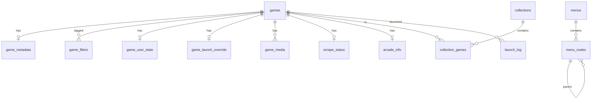

# Data model & configuration schema

Authoritative shapes of all persistent data. The Zod schemas in `packages/shared` are generated
from (and must match) this document; when they diverge, fix one in the same PR.

There are four stores:

| Store | Where | Format | Owner |
|---|---|---|---|
| Settings | `%APPDATA%/NextLevel/settings.json` (+ `backups/`) | JSON, Zod-validated | Launcher `SettingsService` |
| Library | `%APPDATA%/NextLevel/library.db` | SQLite | Launcher `LibraryService` |
| System catalog | `packages/system-catalog` (bundled, read-only) | JSON, Zod-validated | Released with the launcher |
| Service DB | API server volume | SQLite (→ Postgres) | API |

Plus files on disk the user owns (ROMs, media, theme packs) which the launcher reads and indexes
but never rewrites, except media written by the scraper and games installed from the catalog.

---

## 1. Identity rules

- **Systems** have a stable slug `id` (`nintendo-64`, `sega-saturn`, `arcade-mame`), never a display name.
  Display names can change without breaking anything. ([ADR-011](adr/ADR-011-stable-ids.md))
- **Games** have an integer `id` in the library. Natural key: `(system_id, rel_path)` where
  `rel_path` is relative to the system's ROM folder (so the same game found on drive 1 or drive 2
  is the same record).
- **Emulators, profiles, storage locations, collections, menus, nodes** have UUIDv7 IDs.
- **Catalog items** have a UUIDv7 `id` and a human `slug`.

---

## 2. Settings (`settings.json`)

Only the app writes this file. Every field has a default, so an empty file `{ "schemaVersion": 1 }`
is valid and the app fills the rest.

**Implemented so far** (`packages/shared/src/settings/schema.ts`): `schemaVersion`, `general`
(`language`, `startWithWindows`, `setupCompletedAt`) and `experimental` since M1;
`storage.locations` and `systems` (`enabled`, `folderName`, `extensions`) since M2; `emulators`, `profiles` and `systems[id].defaultProfileId` since M3; `storage.assetsPath`, `storage.themesPath` (absolute or null) and `input` since M4a; `general.bootTarget` and `themes` (`activeDefault`, `lastUsed`, `entries`) since M4b; `themes.sound` (on, 50) since M4d, `systems[id].screenscraperId` (positive integer, overrides the catalog id; Settings → Systems, written by the importer) since M5d, and each known theme's `entries[id].settings` is checked against that theme's schema (`packages/shared/src/frontend/themeSettings.ts`: HyperSpin `filtersInMenu`, `wheel`, `menuWheel`; Showcase `filtersInMenu`; unknown keys and unknown themes pass). Theme ids are kept even when unknown (a newer launcher's theme) and fall back to Big Box where used; `themes.lastUsed` is written by main when the front-end opens a theme (`frontend.themeOpened`, only when it changed). An emulator's `executable` is an absolute `.exe`/`.bat`/`.cmd` path (scripts are refused at launch until hooks exist); every profile names an existing emulator and its templates pass §2.1 (`unknownToken`, `unclosedBrace`, `extraArgsAlone`). A `defaultProfileId` or per-game override that names a deleted profile is not an error: resolution falls through (§2.3), and deleting a profile in Settings clears the defaults that named it. Profiles copied from a preset keep `presetProfileId`. Storage paths
must be absolute and unique (compared case-insensitively, either slash, no trailing separator);
priority follows list order. Unknown `systems` keys are kept so a newer catalog survives a downgrade. A `systems` entry, once written, records a decision (switching a system off keeps `{ enabled: false }`); a scan only turns on systems that have no entry (M2b). Each later
section is added, with defaults, by the milestone that uses it; `general.bootTarget` arrives with
themes in M4 (owner decision 2026-10-21). Unknown keys are stripped on load; wrong types make the
file invalid.

```ts
type Settings = {
  schemaVersion: 1;
  general: {
    language: 'en' | 'pt-BR';
    bootTarget: { kind: 'lastTheme' } | { kind: 'theme'; themeId: string } | { kind: 'desktop' };
    startWithWindows: boolean;
    setupCompletedAt: string | null;          // ISO; null → first-run wizard
  };
  storage: {
    locations: StorageLocation[];             // ordered by priority (1 = first)
    managedLocationId: string | null;         // where catalog games are installed
    media: { mode: 'perRomFolder' } | { mode: 'central'; path: string };
    assetsPath: string | null;                // shared menu art
    themesPath: string | null;                // theme packs
  };
  systems: Record<SystemId, SystemSettings>;   // only systems the user touched/enabled
  emulators: Emulator[];
  profiles: EmulatorProfile[];
  themes: {
    activeDefault: string;                    // theme id
    lastUsed: string | null;
    entries: Record<string, ThemeOptions>;    // per-theme option overrides (see §2.5)
    sound: { enabled: boolean; volume: number }; // every theme's navigation sounds, 0–100 (D7)
  };
  input: InputSettings;
  scraper: {
    provider: 'screenscraper';
    regionPriority: string[];                 // e.g. ['us','wor','eu','jp']
    languagePriority: string[];
    artKinds: GameArtKind[];
    hasCredentials: boolean;                  // credentials themselves live in the OS keychain
  };
  kiosk: { enabled: boolean; pinHash: string | null; hide: ('desktop'|'settings'|'themeSwitcher'|'catalog')[] };
  sync: { enabled: boolean };
  experimental: Record<string, boolean>;
};

type StorageLocation = { id: string; name: string; path: string; priority: number; managed: boolean };

type SystemSettings = {
  enabled: boolean;
  folderName?: string;            // default: catalog defaultFolderName
  extensions?: string[];          // default: catalog extensions (lowercase, no dot)
  defaultProfileId?: string;
  screenscraperId?: number;       // default: catalog value
  themeId?: string;               // per-system theme override
};

type Emulator = { id: string; name: string; presetId?: string; executable: string; version?: string };

type EmulatorProfile = {
  id: string;
  name: string;                   // "RetroArch – mupen64plus_next"
  emulatorId: string;
  systems: SystemId[];
  args: string[];                 // one template per argv element, e.g. ['-L', '{emulatorDir}/cores/{core}.dll', '{rom}']
  cwd?: string;                   // template; default {emulatorDir}
  core?: string;                  // RetroArch core name
  archives: 'pass' | 'extract';             // default 'pass'
  env: Record<string, string>;              // default {}; values are templates
  presetProfileId?: string;                 // the preset profile it was copied from
  hooks?: LaunchHook[];           // post-1.0 (FR-EMU-9)
};

type InputSettings = {
  keyboard: Record<InputAction, string[]>;   // KeyboardEvent.code values
  gamepad: Record<InputAction, GamepadButton[]>;
  repeatDelayMs: number;                     // default 400
  repeatRateHz: number;                      // default 10
};
type InputAction = 'up'|'down'|'left'|'right'|'select'|'back'|'home'|'menu'|'help'|'search'
                 | 'favorite'|'hide'|'random'|'tabPrev'|'tabNext'|'pageUp'|'pageDown'|'toDesktop'|'switchTheme';
// GamepadButton: 'a'|'b'|'x'|'y'|'lb'|'rb'|'lt'|'rt'|'view'|'start'|'ls'|'rs'|'dpadUp'|… |'guide'
// plus 'lsUp'|'lsDown'|'lsLeft'|'lsRight' (left stick past 0.5). A gamepad binding is one button
// or a two-button chord ('view+start'). The same binding on two actions is `duplicateBinding`.
```

### 2.1 Template tokens

The only tokens allowed in `args`, `cwd` and `env` values. Unknown tokens fail validation on save.

| Token | Value | Example |
|---|---|---|
| `{rom}` | Absolute path of the ROM (or the extracted file) | `E:\roms\Nintendo 64\Super Mario 64 (USA).z64` |
| `{romDir}` | Directory of `{rom}` | `E:\roms\Nintendo 64` |
| `{romName}` | File name without extension | `Super Mario 64 (USA)` |
| `{romFile}` | File name with extension | `Super Mario 64 (USA).z64` |
| `{romExt}` | Extension without dot | `z64` |
| `{systemId}` | System id | `nintendo-64` |
| `{systemDir}` | System ROM folder on the resolved storage location | `E:\roms\Nintendo 64` |
| `{emulatorDir}` | Directory of the emulator executable | `E:\NextLevel\emulators\retroarch` |
| `{core}` | Profile core or game override | `mupen64plus_next_libretro` |
| `{extraArgs}` | Game override extra args — expands to **zero or more argv elements** | — |
| `{{` / `}}` | Literal braces | — |

### 2.2 Settings rules

- Saves are atomic (write `settings.json.tmp`, fsync, rename). The previous file goes to
  `backups/settings-<ISO>.json`; the newest 10 are kept.
- On load: parse → migrate (`schemaVersion` n → n+1, backup first) → validate. An invalid file is
  never overwritten silently: the app offers *Restore latest backup* or *Reset to defaults*.
- Secrets (ScreenScraper password, refresh token) are **never** in this file; they use Electron
  `safeStorage`-encrypted entries in `secrets.bin`.

### 2.3 Resolution: which emulator runs a game

`game_launch_override.profile_id` → `settings.systems[system].defaultProfileId` → first profile
whose `systems` includes the system → error `NO_PROFILE`.

### 2.4 Resolution: where a game's file is

For storage locations by ascending priority: `<location.path>/<folderName>/<rel_path>`; first
existing wins (cached by the scan, re-checked at launch).

### 2.5 Theme options

Same shape as the current `themes.json` theme entry (`art.logoVariant`, `art.backgroundVariants`,
`art.useVideoBackground`, `art.gameBackgroundSources`, `art.gameArt` (per system id), `settings.*`
such as `filtersInMenu` and wheel options). Precedence: theme defaults (in code) → theme pack
`theme.json` → `settings.themes.entries[id]`. Pack `theme.json` keeps the current schema (see
the current repo's `docs/themes.md`).
HyperSpin `wheel` / `menuWheel` keys and ranges: `width` (`%`, `px` or `vw`), `itemHeight`
24–400, `spacing` 0.3–2, `focusScale` 0.5–3, `shrink` 0–0.5, `minScale` 0.1–1, `focusOffset`
−400–400, `curve` 1–100, `padding` 4 × 0–400, `pointerHeight` 16–1200. Settings edits every
option on a theme page (S9); a value left unset uses the pack's, then the module's.

---

## 3. System catalog (`packages/system-catalog`)

```ts
type SystemDefinition = {
  id: SystemId;                    // 'n64'
  name: string;                    // 'Nintendo 64'
  shortName?: string;              // 'N64'
  manufacturer?: string;           // 'Nintendo' — only where reliably known
  releaseYear?: number;
  kind: 'console' | 'handheld' | 'arcade' | 'computer' | 'pinball' | 'engine' | 'other';
  extensions: string[];            // ['z64','n64','v64','zip','7z']
  defaultFolderName: string;       // 'Nintendo 64' — matches current NextLevelOS folders
  multiDisc?: boolean;
  scraper: { screenscraperId?: number };
  presetProfiles: string[];        // preset profile ids, best first
  aliases?: string[];              // old names, used by the importer
};

type EmulatorPreset = {
  id: string;                      // 'retroarch'
  name: string;
  executableNames: string[];       // ['retroarch.exe'] — used to auto-detect
  homepage: string;
  profiles: Array<Omit<EmulatorProfile, 'id' | 'emulatorId'> & { id: string }>;
};
```

Seeded by `packages/system-catalog/scripts/seed.ts` from the current `launchers.json` keys (all 438
systems; id = slug of the NextLevelOS name), `screenscraper.json` IDs and ES-DE's `es_systems.xml`
(MIT) for extensions, falling back to the NextLevelOS per-system `romext`, then the global
`scanExtensions`. `kind` is `other` where unknown. Since M3 the seed also writes `data/presets.json` (RetroArch per core, MAME per system, standalone emulators) and each system's `presetProfiles`, from `nextlevel-launcher.py`'s `SYSTEM_EMULATORS` and `MAME_CUSTOM_ARGS` (see `packages/system-catalog/README.md`). Versioned with the launcher; user overrides live in
settings.

---

## 4. Library (`library.db`)

SQLite with WAL, foreign keys on. Migrations via Drizzle Kit; `meta.schema_version`.

**Implemented so far** (`apps/launcher/src/main/library/`): `meta`, `games` and `game_metadata`
since M2b; `game_user_state`, `game_filters`, `collections`, `collection_games` and `games_fts`
since M2c; `game_launch_override` and `launch_log` since M3; `game_media` since M4a; `smart_filters`,
`menus`, `menu_nodes` and `collections.source` since M5a (migration `0005`); `arcade_info` since
M5d (migration `0006`, filled by the importer); the other tables arrive
with the milestones that use them, each as a new migration.
- `better-sqlite3` 13 (N-API prebuilds, so one binary serves Node and Electron), `busy_timeout` 5 s.
- `games.rel_path` is `COLLATE NOCASE` and uses `/` (`! Brazil/Game (Brazil).zip`), so the
  natural key ignores case like Windows does.
- `disc_group` is the set's name without the disc tag (`Saga (USA)`) when loose `Disc 1/2` files
  were collapsed into one game (the row points at the first disc); `null` otherwise.
- New games get `game_metadata.title` from the file name (extension and disc tag removed, tags such
  as `(USA)` kept) and `sort_title` = lowercase title; a scan never changes existing metadata.
- Before a migration the existing file is copied to `backups/library-<ISO>-v<old>.db`. A library
  from a newer app version is refused (`LIBRARY_UNAVAILABLE`) and left untouched.
- A scan matches a vanished row to a new file of the same system by basename and size (moved),
  then by extension, size and mtime (renamed, owner decision 2026-10-21), each only when it is
  the single candidate on both sides. **Relink** does the same by hand: the missing row takes the
  other row's file fields and that row is deleted.
- `games_fts` indexes `game_metadata.title` only (`sort_title` is its lowercase copy), as an
  external-content FTS5 table (`unicode61 remove_diacritics 2`, prefix indexes 2 and 3) kept in
  sync by triggers in the hand-written migration `0002_games_fts.sql`. Search text becomes quoted
  prefix terms (`"zel"*`), so typed characters are never FTS syntax.
- No `game_user_state` row means not favorite, not hidden, no rating, never played. Edited
  metadata fields are added to `locked_fields` (sorted JSON array).
- `collections.name` is `COLLATE NOCASE` and unique; `collection_games.position` is dense
  (0..n-1) and only used for the `manual` sort. Drag reorder (`collections.move`, M5c) puts a
  block of games right before an anchor game (or at the end) and renumbers in one transaction, so
  members hidden from the view keep their relative place.
- The `games_system` index from M2b was dropped: the `(system_id, rel_path)` unique index serves
  lookups by system.
- **Smart filters** (FR-LIB-9): `query` is a `SmartFilterQuery` (`packages/shared/src/library/smartFilters.ts`:
  systems, favorite, filters, genre, year range, min players, played/never/within days, sort, limit
  1–10,000) turned into SQL by `smartFilterSql.ts`; missing games never match. Names are unique
  ignoring case (`NAME_TAKEN`). Favorites, Recently played (50) and Most played (50) are created
  once per library at startup, named in the UI language (`meta.smart_filters_seeded`, D10). A
  summary also counts the menus with a node showing the filter (`menus`, for the delete warning).
- **Menus** (FR-MENU-1..3): a save replaces every `menu_nodes` row of that menu in one transaction
  and bumps `menus.revision`; a save from an older `baseRevision` is `CONFLICT` and writes nothing.
  Node ids are unique across all menus: a node id another menu uses is `VALIDATION_FAILED`
  (`details.nodeId`), so copies get new ids (the Menu Editor's "Copy of current" does).
  The first menu created is active; deleting the active one activates the most recently changed
  other one. `source` (`nextlevelos:<file>`) is set for imported menus and collections (D12) and
  null for those made here. While `menus` is empty themes get the generated menu (FR-MENU-3).
- **Resolving a menu for themes** (`main/menus/resolveMenu.ts`): invisible nodes (and subtrees),
  disabled, unknown or empty systems, deleted or empty collections and smart filters, and categories
  left empty are left out. Ids: categories `m:<nodeId>`, references `s:<systemId>`, `c:<id>`,
  `sf:<id>`, filter children `<systemNodeId>:f:<filter>` (only with `filter_tabs`); a reference that
  repeats gets `~2`, `~3`… in document order (`s:snes~2`), which `frontend.games` ignores.
  `menu_nodes.theme_id` is stored but unused until a later milestone (D9).
- **NextLevelOS import** (FR-IMP-1/2, M5d; `main/import/`, `main/library/ImportRepository.ts`):
  a dry run reads the folder (never writes there; `screenscraper.credentials.json` is never
  opened), maps it (§6) and walks the would-be system folders read-only; its `token` hashes every
  read file's name, size and mtime, and the apply refuses a changed folder (`CONFLICT`) or a
  running scan/import (`BUSY`). The apply stages settings (one write and backup, skipped when
  nothing changes) → a scan of the imported systems → games in 2,000-entry transactions →
  collections → menus, emitting `import.progress`. Games match by (system, rel path), then by
  disc set; an entry without a game becomes a missing row (`size 0`, `mtime 0`, D13) that a later
  scan revives by path. Re-import (D12): unlocked metadata fields NextLevelOS has, filters (unless
  locked), favorite and hidden take its values; `play_count` = max, `last_played_at` = later;
  the launch override's core/extra args and `arcade_info` are replaced when NextLevelOS has them
  (`profile_id` kept); absent values never clear data here. Imported collections (by `source`)
  get contents, order and `manual` sort replaced and keep a name changed here; a name taken by
  a collection made here gets ` (NextLevelOS)`. Imported menus are replaced in place by
  `source` and config.json's menu becomes active.



| Table | Columns (type) | Notes |
|---|---|---|
| `games` | `id` int PK, `system_id` text, `rel_path` text, `source` text (`local`/`catalog`), `catalog_item_id` text?, `location_id` text?, `size` int, `mtime` int, `missing` bool, `missing_since` text?, `disc_group` text?, `added_at` text | UNIQUE(`system_id`,`rel_path`) |
| `game_metadata` | `game_id` PK FK, `title`, `sort_title`, `year` int?, `developer`, `publisher`, `genre`, `players`, `description`, `region`, `rating` real?, `locked_fields` json, `updated_at` | `locked_fields` = fields edited by the user; scrapes don't overwrite them |
| `game_filters` | `game_id` FK, `filter` text | PK(`game_id`,`filter`); values: `official`, `homebrew`, `hack`, `translation`, `prototype`, `unlicensed`, … |
| `game_user_state` | `game_id` PK FK, `favorite` bool, `hidden` bool, `user_rating` int?, `play_count` int, `last_played_at` text?, `play_seconds` int | |
| `game_launch_override` | `game_id` PK FK, `profile_id` text?, `core` text?, `extra_args` json | Replaces gamelist `core`/`config`/`shader`/`emulator` fields |
| `game_media` | `game_id` FK, `kind` text, `path` text, `size` int | PK(`game_id`,`kind`); since M4a every scan rebuilds a system's rows from `media/<kind>/<rom stem>.<ext>` (png > jpg > jpeg > webp > gif; mp4 > webm), scrape adds to it in M6; themes read only this |
| `scrape_status` | `game_id` PK FK, `provider`, `provider_game_id`, `status`, `candidates` int, `error` text?, `scraped_at` | |
| `arcade_info` | `game_id` PK FK, `rom`, `parent`, `driver`, `manufacturer` | MAME data |
| `collections` | `id` PK, `name` UNIQUE, `sort` text (`manual`/`title`/`year`), `source` text? UNIQUE, `created_at` | `source` since M5a (import provenance) |
| `collection_games` | `collection_id` FK, `game_id` FK, `position` int | PK(`collection_id`,`game_id`) |
| `smart_filters` | `id` PK (autoincrement), `name` UNIQUE NOCASE, `query` json, `created_at` | `SmartFilterQuery` serialized |
| `menus` | `id` PK, `title`, `active` bool, `revision` int, `source` text? UNIQUE, `created_at`, `updated_at` | at most one active (partial unique index) |
| `menu_nodes` | `id` PK, `menu_id` FK, `parent_id` FK?, `position` int, `type` (`category`/`system`/`collection`/`smartFilter`), `ref_id` text?, `name` text, `display_name`?, `short_name`?, `theme_id`?, `filter_tabs` bool?, `visible` bool | `name` is also the menu-art key (current convention) |
| `launch_log` | `id` PK, `game_id` FK? (set null on delete), `game_title`, `profile_id`, `profile_name`, `argv` json (executable first), `cwd`, `test` bool, `started_at`, `ended_at`?, `exit_code` int?, `error_code` text?, `stderr_tail` text? (last 4 KiB) | keep last 1,000; titles and names are copies so rows outlive renames and deletes; `ended_at` null = still running or the launcher quit first |
| `games_fts` | FTS5(`title`, content=`game_metadata`, content_rowid=`game_id`) | global search; triggers keep it in sync |
| `meta` | `key` PK, `value` | `schema_version` |

**Deleting:** games are never deleted by a scan, only marked `missing`. Uninstalling a catalog
game deletes its row (cascade) after confirmation.

### Game art kinds

`box-front`, `box-back`, `fanart`, `video`, `screenshot-game-play`, `screenshot-title`,
`screenshot-select`, `logo-clear`, `marquee`. Folder on disk: `<systemDir>/media/<kind>/<romName>.<ext>`
(current convention) or `<central>/<systemId>/<kind>/…`.

### Menu art kinds (theme packs and assets folder)

Unchanged from the current app: `logo/clear|silver|steel`, `background/wallpaper|artwork|photo`,
`video`, `art/hardware`, `system-info`, `pointer`, `sound`. Keyed by menu node `name`.

---

## 5. Service database (API)

| Table | Columns | Notes |
|---|---|---|
| `users` | `id` PK, `google_sub` UNIQUE, `email`, `name`, `avatar_url`, `role` (`admin`/`subscriber`), `status` (`active`/`suspended`), `suspended_reason`?, `created_at`, `last_seen_at` | `role=subscriber` is the default; access still needs a subscription |
| `devices` | `id` PK, `user_id` FK, `name`, `platform`, `app_version`, `created_at`, `last_seen_at`, `revoked_at`? | |
| `refresh_tokens` | `id` PK, `device_id` FK, `token_hash` (SHA-256), `expires_at`, `replaced_by`?, `revoked_at`? | rotation + reuse detection |
| `plans` | `id` PK, `slug` UNIQUE, `name`, `device_limit`, `scope_ids` json, `stripe_price_monthly`?, `stripe_price_yearly`?, `archived` bool | |
| `subscriptions` | `id` PK, `user_id` FK, `plan_id` FK, `source` (`stripe`/`comp`/`devmode`), `status` (`active`/`past_due`/`canceled`/`expired`), `current_period_end`, `stripe_customer_id`?, `stripe_subscription_id`?, `granted_by`?, `note`? | one current per user |
| `catalog_scopes` | `id` PK, `slug`, `name`, `description` | e.g. `homebrew-8bit` |
| `catalog_items` | `id` PK, `slug` UNIQUE, `title`, `system_id`, `scope_id` FK, `description`, `year`, `developer`, `publisher`, `genre`, `players`, `license_id` FK, `on_lapse` (`keep`/`remove`), `status` (`draft`/`published`/`unpublished`), `published_at`?, `version` int | publish requires `license_id` |
| `catalog_files` | `id` PK, `item_id` FK, `filename`, `size`, `sha256`, `storage_key`, `role` (`rom`/`disc`/`extra`) | |
| `catalog_media` | `item_id` FK, `kind`, `storage_key` | game art kinds |
| `licenses` | `id` PK, `type` (`author-permission`/`freeware`/`open-source`/`public-domain`/`commercial-license`), `rights_holder`, `contact`, `terms`, `evidence_key`?, `territories` json?, `starts_at`?, `expires_at`?, `verified_by` FK, `verified_at` | see content policy |
| `downloads` | `id` PK, `user_id`, `device_id`, `file_id`, `issued_at`, `ip_hash` | |
| `audit_log` | `id` PK, `actor_id`, `action`, `target_type`, `target_id`, `before` json, `after` json, `at` | append-only |
| `stripe_events` | `id` PK (Stripe event id), `type`, `received_at`, `processed_at`? | webhook idempotency |
| `app_settings` | `key` PK, `value` json | grace days, sign-up mode, allow-list, banner |
| `sync_documents` | `user_id`, `kind` (`settings`/`menus`/`collections`/`userState`), `revision` int, `data` json, `updated_at` | PK(`user_id`,`kind`); M10 |

### Entitlement (computed, returned by `/v1/me/entitlement`, cached by the launcher)

```ts
type Entitlement = {
  userId: string;
  role: 'admin' | 'subscriber';
  status: 'active' | 'grace' | 'none' | 'suspended';
  plan: { slug: string; name: string; deviceLimit: number } | null;
  scopes: string[];               // catalog scope slugs
  checkedAt: string;              // server time
  offlineUntil: string;           // checkedAt + grace days; launcher refuses after this offline
};
```

Admins always get `status: 'active'` and all scopes.

---

## 6. Import mapping (current NextLevelOS → new)

| Current | New |
|---|---|
| `config.json` `storage[]` | `settings.storage.locations` |
| `config.json` `scanExtensions` | dropped (the catalog's lists were seeded from it) |
| `config.json` `assets`, `themesPath` | `settings.storage.assetsPath`, `themesPath` |
| `config.json` `wsl.*`, `squashfs.exe`, `overlay.*`, `extraction.*` | `hookSetting` (unmapped until hooks exist, post-1.0) |
| `config.json` `test.mode`, `test.data`, other keys | `dropped` |
| `config.json` `menu` | which imported menu is `active` |
| `launchers.json` key | matched by name, alias, then case/punctuation-insensitive → system id (`unknownSystem`); a system with a gamelist or a menu node is enabled |
| `launchers.json` `rompath` | `%SYSTEMS_BASE_PATH%/<folder>` → `systems[id].folderName` when not the default; an absolute path is `absoluteRompath` |
| `launchers.json` `romext` | added to the catalog's `extensions` (NextLevelOS scanned `scanExtensions` ∪ `romext`) |
| `launchers.json` `command` | runner commands: emulators come from the optional emulators folder (D14: detection adds preset profiles and `defaultProfileId` only for enabled systems without a profile); non-runner commands are `customCommand` with the text; `emulators`, `gameArt` are `dropped` |
| `menu*.json` | `menus` + `menu_nodes` (`source` `nextlevelos:<file>`); untyped node with children → category; `type:system` → system node (`unknownSystem` dropped); its filter children turn `filter_tabs` on (`favorite` → Favorites tab, nested filters flatten); `type:collection` → collection node, or the system when the name is a launcher key (`noGamelist` dropped); untyped leaf → `untypedEntry`; `theme` → `themeOverride` (D9); `disply` typo accepted as `display` |
| `gamelists/<System>.json` games (name = launcher key; that decides the system) | `games` + `game_metadata` (`genre` or `category` → `genre`; year 1950–2100), `game_filters` (`filter` minus `favorite`, as slugs: `msxdev_2003` → `msxdev-2003`), `game_user_state` (`favorite` filter, `hidden`, `played` string/number/null, `lastPlayedOn` `M/D/YYYY, h:mm:ss AM` local time), `game_launch_override` (`core`; `config`/`alt_game_config` → `--appendconfig <RA>\config\…`, `shader` → `--set-shader <RA>\shaders\…` when RetroArch is known, else `retroarchNotFound`), `arcade_info` (`rom`, `parent`, `driver`, `manufacturer`); `emulator`, `launch_args`, `alt_core` → `perGameEmulator`; `squashfs_exe` → `hookSetting`; `updatedAt`/`ai_updated`/`artfolder` → `scrapeInM6`; `./` and `\` normalized, duplicates and `Disc N` entries merged, `folder` entries reported |
| `gamelists/<Collection>.json` (name not a launcher key) | `collections` + `collection_games` in file order (games resolved by `system` + `filename`, then disc set; members without a game become missing rows); unknown systems `unknownCollectionSystem`; per-entry launch fields `collectionLaunchFields` |
| non-gamelist / unreadable JSON in `gamelists/` | `notAGamelist` / `invalidFile` |
| `themes.json` | `settings.themes` (`activeDefault`; per built-in theme `art` and `settings` key by key, `gameArt` keys mapped from system name to id; unknown themes `unknownTheme`) |
| `screenscraper.json` | `systems[id].screenscraperId` where it differs from the catalog |
| `scrappers/screenscraper.credentials.json` | never read by the importer (keychain in M6, FR-SCR-3) |

Report reasons are `IMPORT_UNMAPPED_REASONS` / `IMPORT_MAPPED_REASONS` in
`packages/shared/src/import/report.ts`, shown through `import.reason.<code>`.
