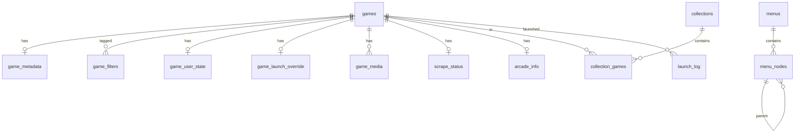

# Data model & configuration schema

Authoritative shapes of all persistent data. The Zod schemas in `packages/shared` are generated
from (and must match) this document; when they diverge, fix one in the same PR.

There are four stores:

| Store | Where | Format | Owner |
|---|---|---|---|
| Settings | `%APPDATA%/NextLevel/settings.json` (+ `backups/`) | JSON, Zod-validated | Launcher `SettingsService` |
| Library | `%APPDATA%/NextLevel/library.db` | SQLite | Launcher `LibraryService` |
| System catalog | `packages/system-catalog` (bundled, read-only) | JSON, Zod-validated | Released with the launcher |
| Service DB | API server volume | SQLite (→ Postgres) | API |

Plus files on disk the user owns (ROMs, media, theme packs) which the launcher reads and indexes
but never rewrites, except media written by the scraper and games installed from the catalog.

---

## 1. Identity rules

- **Systems** have a stable slug `id` (`nintendo-64`, `sega-saturn`, `arcade-mame`), never a display name.
  Display names can change without breaking anything. ([ADR-011](adr/ADR-011-stable-ids.md))
- **Games** have an integer `id` in the library. Natural key: `(system_id, rel_path)` where
  `rel_path` is relative to the system's ROM folder (so the same game found on drive 1 or drive 2
  is the same record).
- **Emulators, profiles, storage locations, collections, menus, nodes** have UUIDv7 IDs.
- **Catalog items** have a UUIDv7 `id` and a human `slug`.

---

## 2. Settings (`settings.json`)

Only the app writes this file. Every field has a default, so an empty file `{ "schemaVersion": 1 }`
is valid and the app fills the rest.

**Implemented so far** (`packages/shared/src/settings/schema.ts`): `schemaVersion`, `general`
(`language`, `startWithWindows`, `setupCompletedAt`) and `experimental` since M1;
`storage.locations` and `systems` (`enabled`, `folderName`, `extensions`) since M2. Storage paths
must be absolute and unique (compared case-insensitively, either slash, no trailing separator);
priority follows list order. Unknown `systems` keys are kept so a newer catalog survives a downgrade. Each later
section is added, with defaults, by the milestone that uses it; `general.bootTarget` arrives with
themes in M4 (owner decision 2026-10-21). Unknown keys are stripped on load; wrong types make the
file invalid.

```ts
type Settings = {
  schemaVersion: 1;
  general: {
    language: 'en' | 'pt-BR';
    bootTarget: { kind: 'lastTheme' } | { kind: 'theme'; themeId: string } | { kind: 'desktop' };
    startWithWindows: boolean;
    setupCompletedAt: string | null;          // ISO; null → first-run wizard
  };
  storage: {
    locations: StorageLocation[];             // ordered by priority (1 = first)
    managedLocationId: string | null;         // where catalog games are installed
    media: { mode: 'perRomFolder' } | { mode: 'central'; path: string };
    assetsPath: string | null;                // shared menu art
    themesPath: string | null;                // theme packs
  };
  systems: Record<SystemId, SystemSettings>;   // only systems the user touched/enabled
  emulators: Emulator[];
  profiles: EmulatorProfile[];
  themes: {
    activeDefault: string;                    // theme id
    lastUsed: string | null;
    entries: Record<string, ThemeOptions>;    // per-theme option overrides (see §2.5)
  };
  input: InputSettings;
  scraper: {
    provider: 'screenscraper';
    regionPriority: string[];                 // e.g. ['us','wor','eu','jp']
    languagePriority: string[];
    artKinds: GameArtKind[];
    hasCredentials: boolean;                  // credentials themselves live in the OS keychain
  };
  kiosk: { enabled: boolean; pinHash: string | null; hide: ('desktop'|'settings'|'themeSwitcher'|'catalog')[] };
  sync: { enabled: boolean };
  experimental: Record<string, boolean>;
};

type StorageLocation = { id: string; name: string; path: string; priority: number; managed: boolean };

type SystemSettings = {
  enabled: boolean;
  folderName?: string;            // default: catalog defaultFolderName
  extensions?: string[];          // default: catalog extensions (lowercase, no dot)
  defaultProfileId?: string;
  screenscraperId?: number;       // default: catalog value
  themeId?: string;               // per-system theme override
};

type Emulator = { id: string; name: string; presetId?: string; executable: string; version?: string };

type EmulatorProfile = {
  id: string;
  name: string;                   // "RetroArch – mupen64plus_next"
  emulatorId: string;
  systems: SystemId[];
  args: string[];                 // one template per argv element, e.g. ['-L', '{emulatorDir}/cores/{core}.dll', '{rom}']
  cwd?: string;                   // template; default {emulatorDir}
  core?: string;                  // RetroArch core name
  archives: 'pass' | 'extract';
  env?: Record<string, string>;
  hooks?: LaunchHook[];           // post-1.0 (FR-EMU-9)
};

type InputSettings = {
  keyboard: Record<InputAction, string[]>;   // KeyboardEvent.code values
  gamepad: Record<InputAction, GamepadButton[]>;
  repeatDelayMs: number;                     // default 400
  repeatRateHz: number;                      // default 10
};
type InputAction = 'up'|'down'|'left'|'right'|'select'|'back'|'home'|'menu'|'help'|'search'
                 | 'favorite'|'tabPrev'|'tabNext'|'pageUp'|'pageDown'|'toDesktop'|'switchTheme';
```

### 2.1 Template tokens

The only tokens allowed in `args`, `cwd` and `env` values. Unknown tokens fail validation on save.

| Token | Value | Example |
|---|---|---|
| `{rom}` | Absolute path of the ROM (or the extracted file) | `E:\roms\Nintendo 64\Super Mario 64 (USA).z64` |
| `{romDir}` | Directory of `{rom}` | `E:\roms\Nintendo 64` |
| `{romName}` | File name without extension | `Super Mario 64 (USA)` |
| `{romFile}` | File name with extension | `Super Mario 64 (USA).z64` |
| `{romExt}` | Extension without dot | `z64` |
| `{systemId}` | System id | `nintendo-64` |
| `{systemDir}` | System ROM folder on the resolved storage location | `E:\roms\Nintendo 64` |
| `{emulatorDir}` | Directory of the emulator executable | `E:\NextLevel\emulators\retroarch` |
| `{core}` | Profile core or game override | `mupen64plus_next_libretro` |
| `{extraArgs}` | Game override extra args — expands to **zero or more argv elements** | — |
| `{{` / `}}` | Literal braces | — |

### 2.2 Settings rules

- Saves are atomic (write `settings.json.tmp`, fsync, rename). The previous file goes to
  `backups/settings-<ISO>.json`; the newest 10 are kept.
- On load: parse → migrate (`schemaVersion` n → n+1, backup first) → validate. An invalid file is
  never overwritten silently: the app offers *Restore latest backup* or *Reset to defaults*.
- Secrets (ScreenScraper password, refresh token) are **never** in this file; they use Electron
  `safeStorage`-encrypted entries in `secrets.bin`.

### 2.3 Resolution: which emulator runs a game

`game_launch_override.profile_id` → `settings.systems[system].defaultProfileId` → first profile
whose `systems` includes the system → error `NO_PROFILE`.

### 2.4 Resolution: where a game's file is

For storage locations by ascending priority: `<location.path>/<folderName>/<rel_path>`; first
existing wins (cached by the scan, re-checked at launch).

### 2.5 Theme options

Same shape as the current `themes.json` theme entry (`art.logoVariant`, `art.backgroundVariants`,
`art.useVideoBackground`, `art.gameBackgroundSources`, `art.gameArt` (per system id), `settings.*`
such as `filtersInMenu` and wheel options). Precedence: theme defaults (in code) → theme pack
`theme.json` → `settings.themes.entries[id]`. Pack `theme.json` keeps the current schema (see
the current repo's `docs/themes.md`).

---

## 3. System catalog (`packages/system-catalog`)

```ts
type SystemDefinition = {
  id: SystemId;                    // 'n64'
  name: string;                    // 'Nintendo 64'
  shortName?: string;              // 'N64'
  manufacturer?: string;           // 'Nintendo' — only where reliably known
  releaseYear?: number;
  kind: 'console' | 'handheld' | 'arcade' | 'computer' | 'pinball' | 'engine' | 'other';
  extensions: string[];            // ['z64','n64','v64','zip','7z']
  defaultFolderName: string;       // 'Nintendo 64' — matches current NextLevelOS folders
  multiDisc?: boolean;
  scraper: { screenscraperId?: number };
  presetProfiles: string[];        // preset profile ids, best first
  aliases?: string[];              // old names, used by the importer
};

type EmulatorPreset = {
  id: string;                      // 'retroarch'
  name: string;
  executableNames: string[];       // ['retroarch.exe'] — used to auto-detect
  homepage: string;
  profiles: Array<Omit<EmulatorProfile, 'id' | 'emulatorId'> & { id: string }>;
};
```

Seeded by `packages/system-catalog/scripts/seed.ts` from the current `launchers.json` keys (all 438
systems; id = slug of the NextLevelOS name), `screenscraper.json` IDs and ES-DE's `es_systems.xml`
(MIT) for extensions, falling back to the NextLevelOS per-system `romext`, then the global
`scanExtensions`. `kind` is `other` where unknown; emulator presets (`presetProfiles`) arrive in M3,
from `nextlevel-launcher.py`'s per-system logic. Versioned with the launcher; user overrides live in
settings.

---

## 4. Library (`library.db`)

SQLite with WAL, foreign keys on. Migrations via Drizzle Kit; `meta.schema_version`.



| Table | Columns (type) | Notes |
|---|---|---|
| `games` | `id` int PK, `system_id` text, `rel_path` text, `source` text (`local`/`catalog`), `catalog_item_id` text?, `location_id` text?, `size` int, `mtime` int, `missing` bool, `missing_since` text?, `disc_group` text?, `added_at` text | UNIQUE(`system_id`,`rel_path`); index `system_id` |
| `game_metadata` | `game_id` PK FK, `title`, `sort_title`, `year` int?, `developer`, `publisher`, `genre`, `players`, `description`, `region`, `rating` real?, `locked_fields` json, `updated_at` | `locked_fields` = fields edited by the user; scrapes don't overwrite them |
| `game_filters` | `game_id` FK, `filter` text | PK(`game_id`,`filter`); values: `official`, `homebrew`, `hack`, `translation`, `prototype`, `unlicensed`, … |
| `game_user_state` | `game_id` PK FK, `favorite` bool, `hidden` bool, `user_rating` int?, `play_count` int, `last_played_at` text?, `play_seconds` int | |
| `game_launch_override` | `game_id` PK FK, `profile_id` text?, `core` text?, `extra_args` json | Replaces gamelist `core`/`config`/`shader`/`emulator` fields |
| `game_media` | `game_id` FK, `kind` text, `path` text, `size` int | PK(`game_id`,`kind`); written by scan/scrape; themes read only this |
| `scrape_status` | `game_id` PK FK, `provider`, `provider_game_id`, `status`, `candidates` int, `error` text?, `scraped_at` | |
| `arcade_info` | `game_id` PK FK, `rom`, `parent`, `driver`, `manufacturer` | MAME data |
| `collections` | `id` PK, `name` UNIQUE, `sort` text (`manual`/`title`/`year`), `created_at` | |
| `collection_games` | `collection_id` FK, `game_id` FK, `position` int | PK(`collection_id`,`game_id`) |
| `smart_filters` | `id` PK, `name`, `query` json | `GameQuery` serialized |
| `menus` | `id` PK, `title`, `active` bool | exactly one active (partial unique index) |
| `menu_nodes` | `id` PK, `menu_id` FK, `parent_id` FK?, `position` int, `type` (`category`/`system`/`collection`/`smartFilter`), `ref_id` text?, `name` text, `display_name`?, `short_name`?, `theme_id`?, `filter_tabs` bool?, `visible` bool | `name` is also the menu-art key (current convention) |
| `launch_log` | `id` PK, `game_id` FK, `profile_id`, `argv` json, `started_at`, `ended_at`?, `exit_code` int?, `stderr_tail` text? | keep last 1,000 |
| `games_fts` | FTS5(`title`, `sort_title`, content=`game_metadata`) | global search |
| `meta` | `key` PK, `value` | `schema_version` |

**Deleting:** games are never deleted by a scan, only marked `missing`. Uninstalling a catalog
game deletes its row (cascade) after confirmation.

### Game art kinds

`box-front`, `box-back`, `fanart`, `video`, `screenshot-game-play`, `screenshot-title`,
`screenshot-select`, `logo-clear`, `marquee`. Folder on disk: `<systemDir>/media/<kind>/<romName>.<ext>`
(current convention) or `<central>/<systemId>/<kind>/…`.

### Menu art kinds (theme packs and assets folder)

Unchanged from the current app: `logo/clear|silver|steel`, `background/wallpaper|artwork|photo`,
`video`, `art/hardware`, `system-info`, `pointer`, `sound`. Keyed by menu node `name`.

---

## 5. Service database (API)

| Table | Columns | Notes |
|---|---|---|
| `users` | `id` PK, `google_sub` UNIQUE, `email`, `name`, `avatar_url`, `role` (`admin`/`subscriber`), `status` (`active`/`suspended`), `suspended_reason`?, `created_at`, `last_seen_at` | `role=subscriber` is the default; access still needs a subscription |
| `devices` | `id` PK, `user_id` FK, `name`, `platform`, `app_version`, `created_at`, `last_seen_at`, `revoked_at`? | |
| `refresh_tokens` | `id` PK, `device_id` FK, `token_hash` (SHA-256), `expires_at`, `replaced_by`?, `revoked_at`? | rotation + reuse detection |
| `plans` | `id` PK, `slug` UNIQUE, `name`, `device_limit`, `scope_ids` json, `stripe_price_monthly`?, `stripe_price_yearly`?, `archived` bool | |
| `subscriptions` | `id` PK, `user_id` FK, `plan_id` FK, `source` (`stripe`/`comp`/`devmode`), `status` (`active`/`past_due`/`canceled`/`expired`), `current_period_end`, `stripe_customer_id`?, `stripe_subscription_id`?, `granted_by`?, `note`? | one current per user |
| `catalog_scopes` | `id` PK, `slug`, `name`, `description` | e.g. `homebrew-8bit` |
| `catalog_items` | `id` PK, `slug` UNIQUE, `title`, `system_id`, `scope_id` FK, `description`, `year`, `developer`, `publisher`, `genre`, `players`, `license_id` FK, `on_lapse` (`keep`/`remove`), `status` (`draft`/`published`/`unpublished`), `published_at`?, `version` int | publish requires `license_id` |
| `catalog_files` | `id` PK, `item_id` FK, `filename`, `size`, `sha256`, `storage_key`, `role` (`rom`/`disc`/`extra`) | |
| `catalog_media` | `item_id` FK, `kind`, `storage_key` | game art kinds |
| `licenses` | `id` PK, `type` (`author-permission`/`freeware`/`open-source`/`public-domain`/`commercial-license`), `rights_holder`, `contact`, `terms`, `evidence_key`?, `territories` json?, `starts_at`?, `expires_at`?, `verified_by` FK, `verified_at` | see content policy |
| `downloads` | `id` PK, `user_id`, `device_id`, `file_id`, `issued_at`, `ip_hash` | |
| `audit_log` | `id` PK, `actor_id`, `action`, `target_type`, `target_id`, `before` json, `after` json, `at` | append-only |
| `stripe_events` | `id` PK (Stripe event id), `type`, `received_at`, `processed_at`? | webhook idempotency |
| `app_settings` | `key` PK, `value` json | grace days, sign-up mode, allow-list, banner |
| `sync_documents` | `user_id`, `kind` (`settings`/`menus`/`collections`/`userState`), `revision` int, `data` json, `updated_at` | PK(`user_id`,`kind`); M10 |

### Entitlement (computed, returned by `/v1/me/entitlement`, cached by the launcher)

```ts
type Entitlement = {
  userId: string;
  role: 'admin' | 'subscriber';
  status: 'active' | 'grace' | 'none' | 'suspended';
  plan: { slug: string; name: string; deviceLimit: number } | null;
  scopes: string[];               // catalog scope slugs
  checkedAt: string;              // server time
  offlineUntil: string;           // checkedAt + grace days; launcher refuses after this offline
};
```

Admins always get `status: 'active'` and all scopes.

---

## 6. Import mapping (current NextLevelOS → new)

| Current | New |
|---|---|
| `config.json` `storage[]` | `settings.storage.locations` |
| `config.json` `scanExtensions` | per-system `extensions` only where they differ from the catalog |
| `config.json` `assets`, `themesPath` | `settings.storage.assetsPath`, `themesPath` |
| `config.json` `wsl.*`, `squashfs.exe`, `overlay.*`, `extraction.*` | reported as unmapped until hooks exist (post-1.0) |
| `config.json` `test.mode`, `test.data` | dropped |
| `config.json` `menu` | which imported menu is `active` |
| `launchers.json` key | matched to `SystemDefinition` by `name`/`aliases` → system id; unmatched reported |
| `launchers.json` `rompath` | `systems[id].folderName` when not the default |
| `launchers.json` `romext` | `systems[id].extensions` |
| `launchers.json` `command` (runner) | default preset profile for the system; custom commands reported for manual review |
| `menu*.json` | `menus` + `menu_nodes`; `type:system` → system node by id, `type:collection` → collection node; `disply` typo accepted as `display` |
| `gamelists/<System>.json` games | `games` + `game_metadata` (`genre` or `category` → `genre`), `game_filters` (`filter` minus `favorite`), `game_user_state` (`favorite` filter, `hidden`, `played`, `lastPlayedOn`), `game_launch_override` (`core`, `emulator`, `config`, `shader`, `alt_*`, `launch_args`), `arcade_info` (`rom`, `parent`, `driver`, `manufacturer`), `scrape_status` (`status`, `error`, `num_candidates`, `game_id`) |
| `gamelists/<Collection>.json` | `collections` + `collection_games` (games resolved by `system` + `filename`) |
| `themes.json` | `settings.themes` (`gameArt` keys mapped from system name to id) |
| `screenscraper.json` | `systems[id].screenscraperId` where it differs from the catalog |
| `scrappers/screenscraper.credentials.json` | keychain (asked, not copied silently) |
