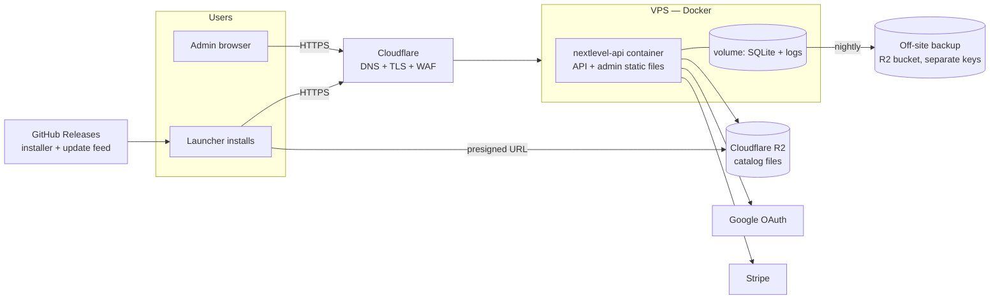

# Deployment & operations

Target setup for production (milestone M10). Choices marked **(proposed)** are defaults to confirm.

## 1. Topology

**(proposed)**: one small VPS (2 vCPU / 4 GB, e.g. Hetzner), Docker Compose, Caddy or Cloudflare
for TLS, Cloudflare R2 for files (no egress fees, which matters for game downloads).

## 2. Launcher distribution

- **Build:** GitHub Actions on `windows-latest`: `npm ci` → test → `electron-builder --win nsis`.
- **Signing:** code-signing certificate (OV or EV; Azure Trusted Signing is a cheaper option) to
  avoid SmartScreen warnings. Secrets in GitHub Actions.
- **Channels:** `beta` and `stable` update feeds on GitHub Releases via `electron-updater`.
  Every release goes to `beta` first for at least 48 h.
- **Versioning:** SemVer. `0.<milestone>.<patch>` until 1.0.
- **Update behaviour:** download in background, install on quit; the user can defer. A minimum
  supported version (`app_settings.minLauncherVersion`) lets the API refuse very old clients with
  `UPDATE_REQUIRED`.

## 3. API & admin deployment

- **Image:** multi-stage Dockerfile builds `apps/api` and `apps/admin`; the API serves the admin
  static files at `/admin`. Tagged `ghcr.io/<owner>/nextlevel-api:<version>`.
- **Deploy:** GitHub Action on tag `api-v*` → push image → SSH `docker compose pull && up -d`.
  Migrations run at container start **after** an automatic DB snapshot.
- **Config:** environment variables (see [environment-setup](environment-setup.md#environment-variables-appsapienv)),
  stored as GitHub environment secrets and written to the server's `.env` (mode 600).
- **Zero-downtime:** not required at this scale; deploys take seconds. Announce maintenance via the
  admin banner for migrations that take longer.

## 4. Backups & recovery

| What | How | Frequency | Retention |
|---|---|---|---|
| API SQLite DB | `sqlite3 .backup` → gzip → R2 backup bucket (separate credentials) | nightly + before each migration | 30 daily, 12 monthly |
| Catalog files | R2 bucket versioning on | continuous | 30 days of versions |
| License evidence | same as catalog files, separate prefix | continuous | life of the item + 3 years |
| Launcher user data | user's machine: settings backups (10), library DB backup before migrations | on change | — |

**Restore drill:** quarterly, restore the latest backup into staging and run the smoke test.
Recovery targets: RPO 24 h, RTO 4 h.

## 5. Monitoring & logging

| Signal | Tool | Alert |
|---|---|---|
| Uptime of `/v1/health` | UptimeRobot / Better Stack (free tier) | 2 consecutive failures → email/Telegram |
| API logs | pino JSON → Docker logs → rotated; optional shipping to Better Stack | error rate > 2% over 5 min |
| Webhook failures | Stripe dashboard + `stripe_events` unprocessed count | any event unprocessed > 10 min |
| Disk usage on VPS | node exporter or simple cron script | > 80% |
| Backups | backup job writes a heartbeat | no heartbeat in 26 h |
| Launcher crashes | local logs; opt-in crash reports (Sentry, scrubbed) | new crash signature |

Logs never contain tokens, email addresses or IPs in clear text (user ID and hashed IP only).

## 6. Runbooks

### Webhook backlog
1. Check Stripe dashboard → Developers → Webhooks for failed deliveries, and
   `select id, type, received_at from stripe_events where processed_at is null`.
2. Fix cause, then "Resend" failed events; idempotency makes this safe (an event already
   processed is answered without work; each event re-reads the subscription from Stripe, so
   order doesn't matter).
3. Confirm `subscriptions` rows updated; affected launchers refresh within an hour.

### "stripe event not applied" in the log
The event was stored as processed but changed nothing (`reason` in the log line):
- `unknownPrice`: the subscription's price is on no plan. The Customer Portal offered a price the
  plans don't carry. Make the Portal's products match the plans (environment-setup → Stripe),
  put the price on the right plan, then resend the event from Stripe.
- `unknownUser`: no `userId` metadata, or the user was deleted. Subscriptions made outside
  NextLevel's checkout are not ours; cancel or refund them in Stripe by hand.
- `userChanged`: the subscription's `userId` metadata was edited in Stripe. Put it back.

### BILLING_UNAVAILABLE (503)
Stripe couldn't be reached or answered with an error. Players see "Billing is unavailable right
now"; nothing was charged or changed. Check https://status.stripe.com and the API log (Stripe
ids only). Webhooks that failed the same way are retried by Stripe for up to 3 days.

### Restore database
1. Stop API container. 2. Download the chosen backup from the backup bucket. 3. Replace the DB
file on the volume. 4. Start the container (migrations run if needed). 5. Run the smoke test.
6. Replay Stripe events since backup time (Stripe → resend) to recover subscription changes.

### Revoke everything for a compromised account
Admin console → user → Suspend (sessions die at next refresh, ≤ 15 min) → revoke all devices.

### Rotate secrets
`JWT_SECRET` rotation supports two active keys (`kid` header): add the new one, deploy, wait 30 days
(refresh lifetime), remove the old one. Google/Stripe/R2 keys: create new, deploy, revoke old.

### Remove a catalog item urgently (takedown)
Admin console → item → Unpublish → set `on_lapse = remove` → launchers remove installed copies at
next `/catalog/changes` sync. Record the request and action in the audit log note.

## 7. Smoke test (after every deploy)

1. `GET /v1/health` → version matches.
2. Admin console loads and signs in.
3. Test subscriber launcher (staging build) signs in, lists catalog, downloads the 1 KB test item.
4. Stripe test webhook (staging) processes.
