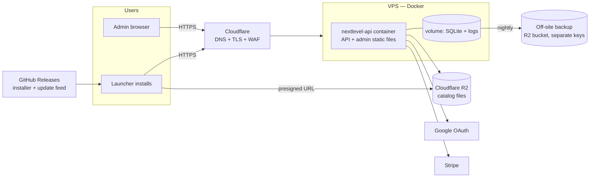

# Deployment & operations

Target setup for production (milestone M10). Choices marked **(proposed)** are defaults to confirm.

## 1. Topology

**(proposed)**: one small VPS (2 vCPU / 4 GB, e.g. Hetzner), Docker Compose, Caddy or Cloudflare
for TLS, Cloudflare R2 for files (no egress fees, which matters for game downloads).

## 2. Launcher distribution

- **Build:** GitHub Actions on `windows-latest`: `npm ci` → test → `electron-builder --win nsis`.
- **Signing:** code-signing certificate (OV or EV; Azure Trusted Signing is a cheaper option) to
  avoid SmartScreen warnings. Secrets in GitHub Actions.
- **Channels:** `beta` and `stable` update feeds on GitHub Releases via `electron-updater`.
  Every release goes to `beta` first for at least 48 h.
- **Versioning:** SemVer. `0.<milestone>.<patch>` until 1.0.
- **Update behaviour:** download in background, install on quit; the user can defer. A minimum
  supported version (`app_settings.minLauncherVersion`) lets the API refuse very old clients with
  `UPDATE_REQUIRED`.

## 3. API & admin deployment

- **Image:** `Dockerfile` (M10c, D56): `node:24-slim`, builds `apps/admin` and serves it from
  `ADMIN_DIST` at `/`; runs `node apps/api/src/server.ts` as the `node` user with the `/data`
  volume (`DATABASE_URL=file:/data/nextlevel.db`, `HOST=0.0.0.0`). Tagged
  `ghcr.io/estivalet/nextlevel-api:<version>` (`apps/api/package.json`).
- **Compose:** `deploy/compose.yaml`: `api`, `caddy` (ports 80/443, certificates for
  `NEXTLEVEL_DOMAIN`, `deploy/Caddyfile`) and `backup` (the same image running
  `apps/api/src/ops/backup.ts --daily`). The server's `.env` comes from `deploy/.env.example`.
- **Deploy:** `.github/workflows/deploy-api.yml`. A manual run builds the image and checks that it
  answers `/v1/health` with its version (no server needed); ticking *deploy*, or pushing an
  `api-v*` tag, pushes the image and runs `docker compose pull && up -d` over SSH, then checks the
  public `/v1/health`. Migrations run at container start **after** an automatic snapshot,
  `<db>.pre-<version>.bak`, next to the database. **Nothing is deployed yet** (D56, no-spending
  rule, 2026-10-30): the API runs locally.
- **Config:** environment variables (see [environment-setup](environment-setup.md#environment-variables-appsapienv)),
  stored as GitHub environment secrets and written to the server's `.env` (mode 600).
- **Zero-downtime:** not required at this scale; deploys take seconds. Announce maintenance via the
  admin banner for migrations that take longer.

## 4. Backups & recovery

| What | How | Frequency | Retention |
|---|---|---|---|
| API SQLite DB | `ops/backup.ts`: SQLite online backup → gzip → the file store at `backups/<date>.db.gz` + `backups/heartbeat.json` (M10c); `<db>.pre-<version>.bak` before migrations | 03:00 UTC daily + before each migration | 30 days |
| Catalog files | `FILE_STORE=local`: `FILES_DIR` on the API machine (default `<database folder>/files`, D40) — back it up with the database; `FILE_STORE=s3`: R2 with bucket versioning on. Files no row names are deleted after 24 h by the maintenance job | continuous | 30 days of versions |
| License evidence | same as catalog files, separate prefix | continuous | life of the item + 3 years |
| Launcher user data | user's machine: settings backups (10), library DB backup before migrations | on change | — |

**Restore drill:** quarterly, restore the latest backup into staging and run the smoke test.
Recovery targets: RPO 24 h, RTO 4 h.

## 5. Monitoring & logging

| Signal | Tool | Alert |
|---|---|---|
| Uptime of `/v1/health` | UptimeRobot / Better Stack (free tier) | 2 consecutive failures → email/Telegram |
| API logs | pino JSON → Docker logs → rotated; optional shipping to Better Stack | error rate > 2% over 5 min |
| Webhook failures | Stripe dashboard + `stripe_events` unprocessed count | any event unprocessed > 10 min |
| Disk usage on VPS | node exporter or simple cron script | > 80% |
| Backups | backup job writes a heartbeat | no heartbeat in 26 h |
| Launcher crashes | local logs; opt-in crash reports (Sentry, scrubbed) | new crash signature |

Logs never contain tokens, email addresses or IPs in clear text (user ID and hashed IP only).

## 6. Runbooks

### Webhook backlog
1. Check Stripe dashboard → Developers → Webhooks for failed deliveries, and
   `select id, type, received_at from stripe_events where processed_at is null`.
2. Fix cause, then "Resend" failed events; idempotency makes this safe (an event already
   processed is answered without work; each event re-reads the subscription from Stripe, so
   order doesn't matter).
3. Confirm `subscriptions` rows updated; affected launchers refresh within an hour.

### "stripe event not applied" in the log
The event was stored as processed but changed nothing (`reason` in the log line):
- `unknownPrice`: the subscription's price is on no plan. The Customer Portal offered a price the
  plans don't carry. Make the Portal's products match the plans (environment-setup → Stripe),
  put the price on the right plan, then resend the event from Stripe.
- `unknownUser`: no `userId` metadata, or the user was deleted. Subscriptions made outside
  NextLevel's checkout are not ours; cancel or refund them in Stripe by hand.
- `userChanged`: the subscription's `userId` metadata was edited in Stripe. Put it back.

### BILLING_UNAVAILABLE (503)
Stripe couldn't be reached or answered with an error. Players see "Billing is unavailable right
now"; nothing was charged or changed. Check https://status.stripe.com and the API log (Stripe
ids only). Webhooks that failed the same way are retried by Stripe for up to 3 days.

### Restore database
1. Stop API container. 2. Download the chosen backup from the backup bucket. 3. Replace the DB
file on the volume. 4. Start the container (migrations run if needed). 5. Run the smoke test.
6. Replay Stripe events since backup time (Stripe → resend) to recover subscription changes.

### Revoke everything for a compromised account
Admin console → user → Suspend (sessions die at next refresh, ≤ 15 min) → revoke all devices.

### Rotate secrets
`JWT_SECRET` rotation supports two active keys (`kid` header): add the new one, deploy, wait 30 days
(refresh lifetime), remove the old one. Google/Stripe/R2 keys: create new, deploy, revoke old.

### Remove a catalog item urgently (takedown)
As built (M9): Admin console → Catalog → the item → **Publish** tab → set **When it leaves the
catalog** to **Remove** (saved at once) → **Unpublish** (confirm). New download links stop at
once (an issued link for an unpublished item answers 410). Installed copies are deleted at each
launcher's next online sign-in check (at start and hourly), and the player sees which games
went. The audit log records the change and the unpublish with the admin. If the license itself is
the problem, saving a new license also unpublishes the item until it is verified again. Write the
request (who asked, when, why) in the item's notes outside the system; the audit log has the
actions.

### Restore a backup

1. `docker compose stop api backup` on the server.
2. Download `backups/<date>.db.gz` from the bucket (R2 dashboard or `rclone`), `gunzip` it.
3. Copy it over `/data/nextlevel.db` in the `data` volume (keep the old file aside).
4. `docker compose up -d`, then the smoke test below. A `.pre-<version>.bak` from a failed
   migration is restored the same way (it isn't gzipped).

## 7. Smoke test (after every deploy)

1. `GET /v1/health` → version matches.
2. Admin console loads and signs in.
3. Test subscriber launcher (staging build) signs in, lists catalog, downloads the 1 KB test item.
4. Stripe test webhook (staging) processes.

## 8. Provisioning (when the owner chooses to host)

Written in M10c and not carried out (D56, D59: no-spending rule, 2026-10-30). In order:

1. **VPS:** one small server (Hetzner CX22 or similar), Ubuntu LTS, SSH key login only, a firewall
   allowing 22, 80 and 443. Install Docker Engine and the compose plugin. Make `/opt/nextlevel`
   and copy `deploy/compose.yaml` and `deploy/Caddyfile` into it.
2. **DNS:** an `A` (and `AAAA`) record for the API host name (e.g. `api.example.com`) to the
   server. Caddy gets the certificate on first start.
3. **R2:** a bucket (`nextlevel-catalog`) with versioning on, and an R2 API token limited to it
   (Object Read & Write). Its endpoint is `https://<account id>.r2.cloudflarestorage.com`. Move
   existing local files in once with `rclone copy <FILES_DIR> r2:nextlevel-catalog` before
   switching `FILE_STORE=s3`.
4. **Server `.env`:** from `deploy/.env.example`, mode 600: `NEXTLEVEL_DOMAIN`, `PUBLIC_URL`, a new
   `JWT_SECRET` (`openssl rand -base64 64`), `ADMIN_EMAILS`, the Google clients (step 6),
   `FILE_STORE=s3` with the R2 values, `BILLING_ENABLED=false`.
5. **GitHub:** repository secrets `DEPLOY_HOST`, `DEPLOY_USER`, `DEPLOY_SSH_KEY` (a deploy-only
   key on the server) and `DEPLOY_URL` (`https://api.example.com`). The image goes to GHCR with
   the workflow's own token.
6. **Google OAuth production clients:** in the production Google Cloud project, a *Desktop app*
   client (launcher) and a *Web application* client (admin) with
   `https://api.example.com/v1/auth/google/callback` as redirect URI; publish the consent screen.
   Launcher builds point at the API with `MAIN_VITE_API_URL` at build time (add it to the release
   workflow's environment then; it isn't set today).
7. **First deploy:** run *Deploy API* with *deploy* ticked (or push `api-v<version>`); it checks
   `/v1/health`. Then the smoke test (§7) and a backup restore drill (§6) on a copy.
8. **Stripe live switch (after D32):** only once the owner's test-mode check passed: live
   products and prices, a live webhook endpoint (`/v1/webhooks/stripe`), `STRIPE_SECRET_KEY` /
   `STRIPE_WEBHOOK_SECRET` live values, then `BILLING_ENABLED=true` and a redeploy (D58).

